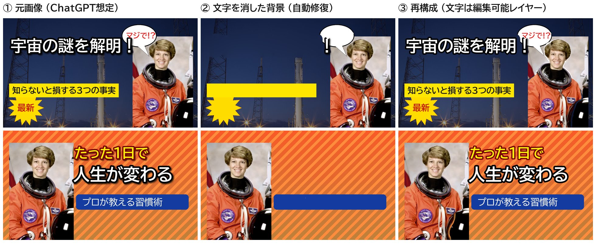
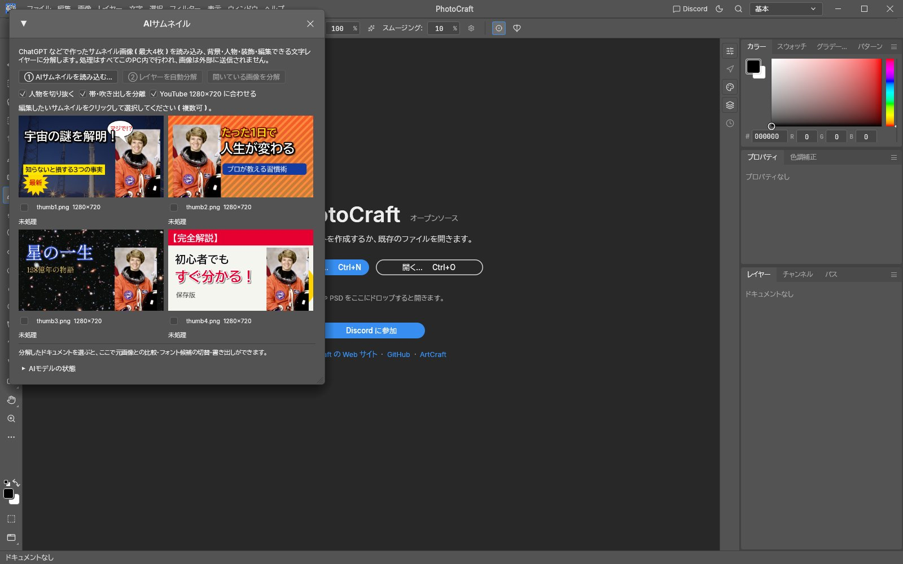
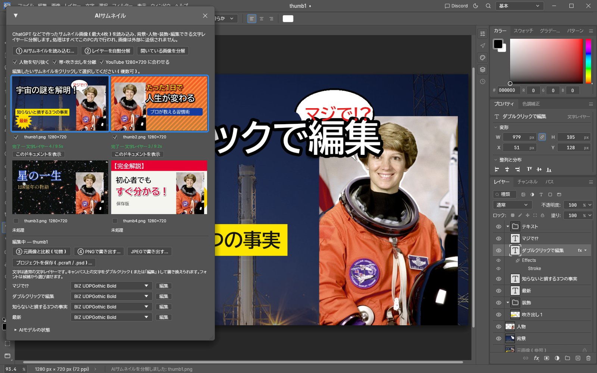

# Plotmill AI Thumbnail Bridge（PhotoCraft 連携）

ChatGPT などで作った **完成済みの YouTube サムネイル画像（PNG/JPEG/WebP）** を、
[PhotoCraft](https://github.com/storytold/photocraft) 上で編集できるレイヤー構造に変換します。

- 背景・人物・装飾（帯／吹き出し／バッジ）を別レイヤーに分離
- **日本語の文字を「編集できる文字レイヤー」として復元**（フォント・サイズ・字間・色・縁取り・影を推定）
- 元の文字は背景から自動で消去（二重表示しない）、元画像は非表示の参照レイヤーとして保持
- 最大 4 枚をまとめて読み込み、プレビューで比較して選んだものだけを分解
- PNG / JPEG 書き出し、PhotoCraft ネイティブ形式（.pcraft）と PSD で保存・再編集

**処理はすべて PC 内で完結します。** 画像を外部に送信せず、API キーも有料 API も不要です
（ChatGPT から画像を保存するだけで使えます。ChatGPT と OpenAI API は別物で、API は使いません）。



---

## 1. 完成した機能

| 要件 | 状態 | 内容 |
|---|---|---|
| AIサムネイルを読み込む | ✅ | PhotoCraft の **ファイル › 読み込み › AIサムネイル…**（最大4枚・複数選択） |
| 4枚のプレビューと選択 | ✅ | **ウィンドウ › AIサムネイル** パネルに 2×2 で表示、クリックで選択 |
| レイヤーを自動分解 | ✅ | 選んだ画像ごとに独立したワーカーで並列処理し、別々のドキュメントとして開く |
| 背景 / 人物 / 装飾の分離 | ✅ | `背景`・`人物`（透過PNG相当）・`装飾 › 帯/吹き出し/バッジ` |
| 文字の背景修復（インペイント） | ✅ | 平坦な面はなめらかな補間、模様のある面は PhotoCraft のコンテンツに応じた塗りつぶし |
| 元画像を非表示の参照レイヤーで保持 | ✅ | `元画像（参照）`（非表示・ロック） |
| 日本語 OCR | ✅ | PaddleOCR PP-OCRv6（ひらがな・カタカナ・漢字・英数字） |
| 編集可能な文字レイヤーの生成 | ✅ | PhotoCraft のエンジンコマンド `type.create` で作成（通常の文字レイヤー） |
| フォント推定・候補提示 | ✅ | 利用可能な日本語フォントを実際に描画して形状比較。上位5候補をパネルのプルダウンで切替 |
| サイズ・太さ・字間・行位置 | ✅ | サイズ/字間はフィッティング、太さは書体ウェイト選択、ベースライン位置を復元 |
| 文字色（文字ごとの色分けを含む） | ✅ | 塗り色を推定。1行内で色が変わる場合は文字ごとのランに分割 |
| 縁取り・ドロップシャドウ・光彩 | ✅（一部制限） | PhotoCraft のレイヤースタイル（境界線・ドロップシャドウ・光彩（外側））として設定 |
| 位置と回転 | ✅ | 約3°以上の傾きは回転として復元（縦書きは基本対応・未検証） |
| 文字をダブルクリックして編集 | ✅ | **移動ツールで文字をダブルクリック → その位置で文字編集**（Photoshop と同じ動作を PhotoCraft に追加） |
| 元画像と比較 | ✅ | パネルの「元画像と比較（切替）」：元画像だけ表示 ⇄ 編集結果 |
| 完成画像を書き出す | ✅ | PNG / JPEG（1280×720） |
| 編集可能な状態で保存・再読み込み | ✅ | .pcraft と .psd で保存→再読込しても文字レイヤー・効果・順序を保持 |
| YouTube 1280×720 | ✅ | 16:9 以外の画像は、文字を切らない位置を選んで 1280×720 に合わせる（オフにも可） |
| CLI / 自動化 | ✅ | `plotmill` コマンド、PhotoCraft の制御チャネル／MCP ブリッジから UI コマンドで操作可 |

### PhotoCraft 側への変更（最小限・追加のみ）

`patches/photocraft-ai-thumbnail.patch`（26ファイル、**追加 976 行・削除 0 行**）。PhotoCraft の既存機能は変更していません。

- `crates/ui-egui/src/ai_thumbnail_ui.rs`（新規）：AIサムネイルパネル（egui）と UI コマンド
- `Services::ai_thumbnail`（新規フック）：重い AI 処理はデスクトップアプリ側から注入（`ui-egui` は ML 依存なし・Web 版もビルド可）
- `apps/photocraft/src/ai_thumbnail.rs`（新規）：ブリッジ本体の呼び出し（cargo feature `ai-thumbnail`）
- メニュー 2 項目 + 自動化用コマンド、全 16 言語の翻訳（PhotoCraft のテストが要求）
- 移動ツールでの文字ダブルクリック編集（`type_tool::edit_at`）とそのテスト

画像編集エンジンは新規開発していません。文字レイヤー・レイヤースタイル・塗りつぶし（インペイント）・合成・PSD/.pcraft 入出力・フォント描画は、すべて PhotoCraft の既存実装を使っています。

---

## 2. 起動方法

### 必要なもの
- Rust 1.95 以上（https://rustup.rs）、git、curl
- Linux の場合は PhotoCraft の実行ライブラリ（例：Ubuntu `sudo apt install libxkbcommon-x11-0`）

### 初回セットアップ（1回だけ）
```sh
git clone <このリポジトリ> sindan
cd sindan/thumbnail-bridge
scripts/setup.sh          # PhotoCraft 取得＋パッチ適用、フォント・AIモデル取得、リリースビルド
```
`setup.sh` が行うこと（すべてバージョン固定・SHA-256 検証付き）：
1. PhotoCraft を固定リビジョン `334ae57` で取得し、パッチを適用（`third_party/photocraft`）
2. 日本語フォント（storytold/craft-fonts、OFL）を取得
3. ONNX Runtime 1.28.0（Microsoft 公式・**テレメトリ送信機能なし**のビルド）
4. AI モデル：PP-OCRv6 検出・認識（PyPI の RapidOCR 3.10.0 から抽出）、U²-Net 人物セグメンテーション
5. `cargo build --release`（初回は 15〜40 分程度）

### 起動
```sh
scripts/run-photocraft.sh        # PhotoCraft（AIサムネイル機能入り）
scripts/plotmill.sh doctor       # モデル・ランタイム・日本語フォントの確認
```

対応状況：Linux x86_64 で動作確認済み。macOS (Apple Silicon)・Linux arm64 はスクリプト対応済み・未検証。
Windows は未対応（手順は §8 参照）。

---

## 3. 使い方

### PhotoCraft の画面で（推奨）



1. **ファイル › 読み込み › AIサムネイル…** で ChatGPT から保存した画像を選ぶ（最大4枚）
2. パネルのプレビューで、編集したいサムネイルをクリックして選択（青枠）
3. **② レイヤーを自動分解** を押す（1枚あたり数秒〜十数秒）。終わると別タブで開きます
4. 文字を書き換える：**移動ツールで文字をダブルクリック**（または文字ツールでクリック／パネルの「編集」）
5. フォントを変える：パネルの文字一覧のプルダウンから候補を選ぶ（一致度％付き）
6. **③ 元画像と比較（切替）** で元の画像と見比べる
7. **④ PNGで書き出す…**（または JPEG）、**プロジェクトを保存（.pcraft / .psd）…** で保存



すでに開いている画像は、パネルの **開いている画像を分解** でも変換できます。

### コマンドラインで
```sh
scripts/plotmill.sh convert a.png b.png --out out/ --formats pcraft,psd,png,jpg
scripts/plotmill.sh inspect out/a.pcraft                       # レイヤーと文字の一覧
scripts/plotmill.sh edit-text out/a.pcraft --layer 人生が変わる --text "新しい文字" --out out/a2.pcraft
scripts/plotmill.sh export out/a2.pcraft --out out/a2.png
```
`convert` は画像ごとに `<名前>.report.json`（推定したフォント・色・縁取り・影・候補・処理時間）も出力します。
オプション：`--canvas original`（サイズを変えない）、`--no-person`、`--no-decor`、`--fonts <フォルダ>`（追加フォント）。

### 自動化（AIエージェント / MCP）
PhotoCraft を `--control <port>` 付きで起動すると、制御チャネル（および `photocraft-cli mcp --bridge`）から次の UI コマンドを実行できます。
ファイルは `--automation-read-root` / `--automation-write-root` の範囲内だけ読み書きします。

| コマンド | パラメータ |
|---|---|
| `aiThumbnail.import` | `{"paths": ["a.png", …]}`（最大4） |
| `aiThumbnail.decompose` | `{"indices": [0,1]}` または `{"active": true}` |
| `aiThumbnail.compare` | なし（切替） |
| `aiThumbnail.export` | `{"format": "png"\|"jpg", "path": "out.png"}` |
| `window.aiThumbnail` | `{"open": true}` |

`tools/gui_e2e.py` がこの方法で GUI を端から端まで操作するテストです。

---

## 4. 動作検証結果

テスト画像：`samples/thumb1〜4.png`（1280×720、`tools/make_samples.py` で生成。NASA のパブリックドメイン写真と OFL フォントで「ChatGPT 風」サムネイルを合成し、正解データ `*.truth.json` 付き）。

### 文字の復元精度（13行、`tools/score.py` / `tests/mvp.rs`）

| 項目 | 結果 |
|---|---|
| フォントファミリー（ゴシック/明朝の判別を含む） | **13/13** |
| 太さ（Regular/Bold） | **13/13** |
| 文字サイズ（誤差4%以内） | **13/13**（実測誤差 0〜2px） |
| 文字色 | **13/13** |
| 縁取り（有無・色・太さ±2px） | 12/13 |
| ドロップシャドウ（有無） | 10/13 |
| 文字列の完全一致 | 12/13（小書き「っ」の誤読は形状比較で自動修正） |

うまくいかなかった3件（§5 の制限事項）：吹き出しに接した「！」の読み落とし、背景とほぼ同色（白に白）の縁取り、暗い夜空の上の黒い影・ごく弱い光彩。

### MVP 完成条件

| # | 条件 | 結果 | 確認方法 |
|---|---|---|---|
| 1 | サムネイル PNG を読み込める | ✅ | `tests/mvp.rs`、GUI E2E |
| 2 | 日本語テキストを検出できる | ✅ | 13行すべて検出 |
| 3 | テキストレイヤーを生成できる | ✅ | 全行が PhotoCraft の文字レイヤー（Type） |
| 4 | PhotoCraft で文字を書き換えられる | ✅ | GUI：移動ツールのダブルクリック→入力、文字ツールのクリック→入力、`type.edit` |
| 5 | 元のデザインに近い文字装飾 | ✅ | 縁取り・影を PhotoCraft のレイヤースタイルで再現（上表） |
| 6 | 人物を独立レイヤーに分離 | ✅ | 4枚とも `人物` レイヤー |
| 7 | 背景と人物を個別に操作 | ✅ | 別レイヤー。人物の後ろの背景も補完 |
| 8 | PNG で出力 | ✅ | PNG/JPEG 書き出し（GUI・CLI） |
| 9 | 編集可能な状態で保存・再読み込み | ✅ | .pcraft と .psd を再読込→文字・フォント・サイズ・効果・順序が一致→再編集可 |

### その他の検証
- **GUI エンドツーエンド**（実際の PhotoCraft を仮想ディスプレイで起動し制御チャネルで操作）：4枚読み込み → 2枚を並列分解（8.3秒）→ レイヤー構成確認 → 移動ツールでダブルクリック編集 → 比較切替 → PNG 書き出し → .pcraft/.psd 保存：すべて成功（`tools/gui_e2e.py`）
- **外部通信なし**：`strace` で変換処理中の `connect()` を監視 → CLI は 0 回、GUI もローカル（X11・制御ポート）以外 0 回
- **PhotoCraft のテスト**：`ui-egui` 1,840 件中 1,839 件成功（失敗1件は GPU が無い環境に依存するテストで、今回の変更とは無関係）、追加テスト（パネル3件・ダブルクリック編集1件）成功、clippy（警告ゼロ）・レイヤー依存チェック・Web（wasm）ビルドチェック成功
- **再現性**：空の状態から `setup.sh` を実行し、同一のソースツリー・モデルが得られることを確認
- **処理時間**（4コア CPU のみ・デバッグビルド）：1280×720 1枚あたり約4〜9秒

---

## 5. 未完成・制限事項

| 項目 | 状況と原因 | 必要な対応 |
|---|---|---|
| 実際の ChatGPT 画像での検証 | 開発環境から ChatGPT 画像を入手できず、合成サンプルで検証 | お手持ちの ChatGPT 画像での確認をお願いします（不具合時は `report.json` を共有ください） |
| GitHub への PhotoCraft フォーク公開 | 外部公開にあたるため未実施。パッチ＋セットアップスクリプトで代替 | ご承認いただければフォークを作成してパッチをコミットします |
| Windows | セットアップスクリプト未作成・未検証 | §8 の手動手順、または今後スクリプト化 |
| 吹き出し等に接した記号 | 「！」が吹き出しと一体化すると OCR が読み落とし、装飾側に残る | 手動で修正可能（文字レイヤーに「！」を追加し、装飾レイヤーを修正） |
| 背景とほぼ同色の縁取り・弱い影/光彩 | 検出しないため、レイヤースタイルに入らない（文字の消去は行う） | 効果の微調整は PhotoCraft のレイヤースタイルで |
| 人物の背後の背景 | 大きな領域の補完は近似（人物を動かすと粗が見える場合あり） | 将来 LaMa などの学習ベース修復を任意で追加 |
| 装飾の分離範囲 | 文字の下にある単色の帯・吹き出し・バッジのみ。文字のないイラスト等は背景に残る | 将来：汎用の領域分割（SAM 系）を追加 |
| 縦書き・回転文字 | 実装済みだがサンプルでの検証は横書きのみ | 縦書きサンプルでの検証 |
| PSD 保存時のフォント候補 | PSD に任意メタデータを格納できないため、候補一覧は .pcraft のみに保存 | 編集途中は .pcraft で保存してください |
| OpenAI Images API 連携 | 要件どおり今回は未実装。`src/source.rs` の `ImageSource` を拡張点として用意 | 追加時は API キーを環境変数から読み、明示操作時のみ送信 |

---

## 6. 技術選定

ローカル処理・無料・オープンソースを条件に比較しました。

| 用途 | 採用 | 比較した候補と不採用理由 |
|---|---|---|
| 日本語 OCR | **PaddleOCR PP-OCRv6 small**（Apache-2.0、ONNX、検出+認識 30MB、1枚 0.3〜0.5秒） | Tesseract jpn（縁取り文字に弱い・C ライブラリ導入が必要）、manga-ocr（PyTorch と HuggingFace 依存・行検出なし）、EasyOCR（PyTorch で重い）、YomiToku（CC BY-NC-SA で商用不可）、クラウド OCR（有料・外部送信） |
| 推論ランタイム | **ONNX Runtime 1.28.0**（MIT、Rust の `ort` から動的ロード） | tract（純Rust：PP-OCR と U²-Net の演算子が未対応で読み込み不可を実測）、candle/burn（該当モデルの移植なし）。**1.29 以降の公式ビルドは Linux/macOS でも利用統計を Microsoft に送信する機能が既定で有効**だったため（実測で送信試行を確認）、送信機能を含まない 1.28.0 に固定し、送信機能入りのライブラリは読み込みを拒否する安全装置も実装 |
| 人物切り抜き | **U²-Net human seg**（Apache-2.0、ガイデッドフィルタで輪郭補正） | u2netp（軽量だが精度不足）、MODNet（配布元から取得不可）、BiRefNet（高精度だが重い）、SAM2（プロンプトが必要・重い） |
| 背景修復 | **PhotoCraft 内蔵**：平坦面はメンブレン補間、模様面は PatchMatch 系コンテンツに応じた塗りつぶし | LaMa（高品質だがモデル 200MB・配布元から取得不可）→将来の任意機能 |
| 文字装飾の解析 | 色ヒストグラムの尤度比で文字ピクセルを抽出し、**囲み関係**で塗り/縁取りを判定、距離変換で縁取り幅、相関で影のずれ・ぼかしを推定 | 学習モデル（日本語向けの公開モデルなし） |
| フォント推定 | **PhotoCraft の文字エンジンで候補フォントを実際に描画し形状一致度で順位付け**（サイズ・字間も同時に当てはめ）。小書き「っ/つ」・全角/半角の取り違えも同じ方法で補正 | 画像分類型フォント推定（日本語の公開モデルなし）。この方式なら、PC に入っている任意のフォントが候補になり、PhotoCraft で描画した結果と見た目が一致 |

AI モデルのライセンス：PP-OCRv6（Apache-2.0、Baidu/PaddleOCR）、U²-Net（Apache-2.0、Qin et al.）、ONNX Runtime（MIT）、craft-fonts の日本語フォント（SIL OFL 1.1）。各ライセンス文書は `models/` に保存されます。

---

## 7. セキュリティ

- **外部送信なし**：解析・修復・保存はすべてローカル。ネットワークを使うのは `setup.sh` の初回ダウンロード時だけ（github.com・pypi.org、全ファイル SHA-256 検証）
- ONNX Runtime の利用統計送信：送信機能のない 1.28.0 を使用し、API でも無効化。送信機能を含むライブラリは `ORT_DISABLE_TELEMETRY=1` が無い限り読み込みを拒否
- API キー不要。ソースコードに認証情報は含まれません
- ファイルアクセスの制限：GUI はユーザーがダイアログで選んだファイルのみ。自動化経由は PhotoCraft の `--automation-read-root/--automation-write-root` の範囲のみ（PhotoCraft の既存ポリシーに従い `file.*` コマンドは使わない）。CLI は出力先フォルダの外に書かず、既存ファイルは `--force` なしで上書きしない。入力は 64MB・8192px まで
- 依存関係：`ort`（MIT/Apache）、`sha2`、`serde`、`rayon` のみ追加。外部コードはバージョン固定（PhotoCraft・フォントは git リビジョン、ダウンロード物はハッシュ）
- PhotoCraft 本体への変更は追加のみ（既存コードの削除・変更なし）。既存テストで回帰がないことを確認

---

## 8. 今後の改善点

1. 実際の ChatGPT 画像での精度確認と調整（特に写真的な背景・グラデーション文字）
2. Windows 用セットアップ（PowerShell）と配布パッケージ化
3. 影・光彩の推定を「効果を実際に描画して比較」する最適化方式に（精度向上）
4. 文字のないイラスト・アイコンの装飾分離（SAM 系の領域分割）
5. 背景修復に LaMa を任意追加（人物の背後など大きな欠損）
6. 1行内でサイズが混在する文字、アーチ状など変形文字（PhotoCraft のワープ文字）への対応
7. 追加フォント（Google Fonts の日本語書体など）の候補への自動登録
8. OpenAI Images API による生成→即分解の連携（API キーは環境変数、明示操作時のみ）
9. PhotoCraft 本家へのアップストリーム提案（`Services::ai_thumbnail` フックと Move ツールのダブルクリック編集）

Windows で試す場合の手動手順（未検証）：PhotoCraft を固定リビジョンで clone → `git apply patches/photocraft-ai-thumbnail.patch` →
`models/` に ONNX Runtime 1.28.0（`onnxruntime-win-x64-1.28.0.zip` の `onnxruntime.dll`）と 3 つのモデルを配置 →
`CRAFT_FONTS_DIR` を設定して `cargo build --release -p photocraft`。

---

## 9. ファイル構成

```
thumbnail-bridge/
  src/                 ブリッジ本体（Rust）
    ocr.rs             PP-OCRv6 検出・認識（ONNX）
    style.rs           文字の塗り/縁取り/影/光彩・色ランの解析
    fontmatch.rs       PhotoCraft の文字エンジンによるフォント推定・OCR補正
    segment.rs         人物マット（U²-Net＋ガイデッドフィルタ）
    decor.rs           帯・吹き出し・バッジの抽出
    inpaint.rs         背景修復（PhotoCraft の補間・コンテンツに応じた塗りつぶし）
    pipeline.rs        全体の流れ（キャンバス調整→OCR→…→フォント）
    document.rs        PhotoCraft ドキュメントの構築（type.create 等のエンジンコマンド）
    models.rs          モデル・ランタイムの読み込み、SHA-256 検証、送信機能の拒否
    source.rs          画像の入手元（ローカルファイル／将来の API 連携の拡張点）
    main.rs            CLI `plotmill`
  patches/             PhotoCraft へのパッチ（UI パネル・フック・ダブルクリック編集）
  scripts/             setup.sh / run-photocraft.sh / plotmill.sh / dev-env.sh
  samples/             テスト用サムネイルと正解データ
  tests/mvp.rs         MVP 受け入れテスト
  tools/               サンプル生成・精度採点・GUI E2E テスト
  docs/images/         この README の図
```
